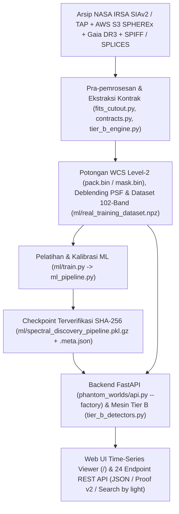

# Phantom Worlds

[](https://github.com/reicchii/el-repo/actions/workflows/ci.yml)

**Phantom Worlds** adalah aplikasi web dan *pipeline* Machine Learning untuk **NASA Space Apps Challenge 2026 — Challenge 12 (*"Planet X and SPHEREx"*)**. Alat ini memampukan siapa pun menampilkan citra langit **NASA SPHEREx** sebagai deret waktu (*time series*), membuang bintang katalog yang sudah diketahui, mencari sumber berdasarkan spektrum 102 pita inframerah, membaca fitur molekul es, memperkirakan jenis objek secara probabilistik (*estimate*) beserta kepercayaan yang terkalibrasi, serta menyaring artefak detektor sebelum tinjauan manusia.

> [!NOTE]
> Keluaran model bersifat probabilistik (**estimasi**, bukan *"confirmed"* / *"discovered"* / *"verified"*), sedangkan pembacaan molekul melaporkan kekuatan fitur serta kedalaman optik terintegrasi (`integrated_tau`). Persentase komposisi hanya ditampilkan untuk es terhadap es air.

---

## Arsitektur Sistem & Alur Data

Sistem bekerja menyeluruh (*end-to-end*) mulai dari pengambilan arsip astronomi hingga penyajian ke antarmuka Web UI dan REST API:



1. **Data & Akuisisi (`download_real_spherex_gaia.py`, `build_ml_catalog.py`, `fits_cutout.py`, `real_ml_data.py`):** Menemukan frame SPHEREx lewat IRSA SIAv2/TAP dan *cross-match* Gaia DR3/2MASS/CatWISE/SPIFF/SPLICES, membaca rentang byte HTTP 206 FITS S3 secara hemat (*range read*), dan membangun dataset spektral 102-band [`ml/real_training_dataset.npz`](ml/real_training_dataset.npz).
2. **Pra-pemrosesan & Deblending (`contracts.py`, `tier_b_engine.py`):** Menguantisasi kubus fluks/bitmask terkalibrasi (`pack.bin` / `mask.bin`), mempropagasi posisi gerak (*proper motion*) ke epoch pengamatan, lalu mengurangi model PSF bintang yang diketahui untuk menghasilkan citra *residual* dan spektrum bersih.
3. **Pelatihan & Model Terlatih (`ml/train.py`, `ml_pipeline.py`):** Melatih ansambel Layer 1–3 (*template $\chi^2$ + cosine kNN* `E1`, *NaN-native HistGradientBoosting* `E2`, gerbang paralaks `E4`, stacking `LogisticRegression`, kalibrasi `IsotonicRegression` + suhu, set conformal, regresor subtipe UCD, dan *screening* kebaruan `IsolationForest`) secara *zero-leakage* berbasis petak langit HEALPix Order 8. Model diekspor secara atomik ke [`ml/spectral_discovery_pipeline.pkl.gz`](ml/spectral_discovery_pipeline.pkl.gz).
4. **Inferensi, Verifikasi & Antarmuka (`api.py`, `tier_b_detectors.py`, `tier_b_proof.py`, `static/`):** Saat startup, server FastAPI memuat otomatis checkpoint terverifikasi hash (~0,03 detik) bersama model penyaring artefak in-memory `M1` (`RandomForestClassifier`), melayani Web UI di `/` serta analisis spektrum langsung lewat `POST /api/analyze/spectrum`.

---

## Struktur Proyek Aktual

Direktori aktif saat ini berpusat pada paket `phantom_worlds/`, `phantom_worlds_dataset_kit/`, `ml/`, dan `proof/`. *(Catatan: direktori roadmap pemisahan lane seperti `engine/`, `api/`, `web/`, `contracts/`, `pyproject.toml`, dan `package.json` yang tercantum di panduan kontributor masih berstatus rencana dan belum dibuat pada pohon berkas saat ini).*

```text
.
├── .env.example                       # Template variabel lingkungan (deployment + runtime API opsional)
├── AGENTS.md                          # Aturan wajib agen & pengembang (aturan bahasa, jujur metrik, lisensi)
├── CLAUDE.md                          # Konfigurasi sesi Claude Code (memuat AGENTS.md)
├── CONTRIBUTING.md                    # Alur klaim tugas, cabang, review PR, & merge
├── LICENSE                            # Lisensi Apache-2.0
├── README.md                          # Dokumen utama ini
├── SETUP.md                           # Panduan setup lintas lingkungan (lokal, Codespaces, cloud)
├── architecture_decision_records.md   # Rekaman Keputusan Arsitektur (ADR 001 – ADR 006)
├── requirements.txt                   # 12 dependensi Python langsung
├── requirements.lock                  # 43 paket Python ter-pin & ber-hash SHA-256
├── phantom-worlds-product-v2.md       # Spesifikasi produk Tier A/B & Proof v2
├── phantom-worlds-ml-research.md      # Rancangan riset spektral 102-band & M1–M3
├── system_specifications.md           # Spesifikasi sistem & batasan teknis
├── technical_architecture.md          # Arsitektur teknis S3/cutout/viewer
│
├── ml/                                # Artefak model terlatih & skrip training
│   ├── train.py                       # Skrip CLI pelatihan & evaluasi model
│   ├── spectral_discovery_pipeline.pkl.gz   # Model ML terlatih utama (1,84 MB / 1.844.039 byte)
│   ├── spectral_discovery_pipeline.meta.json# Checksum SHA-256 & pin versi sklearn/numpy
│   ├── real_training_dataset.npz      # Dataset 102-band SPHEREx + SPIFF (763 spektra)
│   ├── dataset_manifest.json          # Komposisi gold/silver per kelas & petak HEALPix
│   ├── evaluation_report.json         # Laporan evaluasi lengkap (Release Gate, B11–B13, 5 target)
│   └── model_card.md                  # Model card ringkas hasil generate otomatis
│
├── proof/                             # Pembuktian ilmiah otomatis Proof v2
│   ├── run.py                         # CLI pembangkit proof/report.json & proof/report.md
│   ├── report.json                    # Laporan lengkap Tier A & Tier B (B1–B13, 182 kasus)
│   └── report.md                      # Ringkasan Markdown laporan Proof v2
│
├── phantom_worlds/                    # Aplikasi backend, engine sains, ML & Web UI aktif
│   ├── api.py                         # Server FastAPI (create_app factory, 24 endpoint HTTP)
│   ├── contracts.py                   # Loader kontrak Hour-0, propagasi gerak, builder fallback JS
│   ├── fits_cutout.py                 # Pembaca HTTP Range FITS S3 Level-2 & pembentuk WCS cutout
│   ├── ml_pipeline.py                 # SpectralDiscoveryPipeline, molekul Layer 1 & utilitas checkpoint
│   ├── real_ml_data.py                # Ekstraktor HiPS5 cube S3 + SPIFF/SPLICES ke dataset .npz
│   ├── sso.py                         # Client ephemeris objek Tata Surya (IRSA MOST / 3I/ATLAS)
│   ├── tier_a_metrics.py              # Metrik penyelarasan Gaia & astrometri Tier A
│   ├── tier_b_engine.py               # Joint PSF subtraction, deblending & bidang W1925 / RW Aurigae
│   ├── tier_b_detectors.py            # Model M1 (RandomForest in-memory), Search by light, Identity v2
│   ├── tier_b_proof.py                # Evaluator B1–B13, searched depth B8/B9, antrean kasus
│   └── static/                        # Frontend vanilla HTML/CSS/JS + offline fallback_data.js
│
├── phantom_worlds_dataset_kit/        # Kontrak biner Hour-0, katalog, pengunduh & pytest suite
│   ├── csv_tables/                    # Tabel benchmark (5 target NASA, 102-band spectra, 1.446 katalog ML)
│   ├── hour0_contracts/               # Fixture biner TGT-01..05, cases/sources JSON, fields w1925 & rwaur
│   ├── scripts/                       # build_ml_catalog.py, download_real_spherex_gaia.py, data_real/
│   └── tests/                         # 8 berkas tes pytest (kontrak, ML, downloader, FITS, Tier B 1–3)
│
├── docs/                              # Dokumentasi terstruktur, riset sumber & catatan AI
│   ├── MODEL_CARD.md                  # Dokumentasi lengkap model terlatih, metrik & batas keamanan
│   ├── USAGE.md                       # Panduan lengkap UI, 24 endpoint API, inferensi CLI & troubleshooting
│   ├── PROJECT-CONTEXT.md             # Spesifikasi produk penuh, bahasa antarmuka & rencana kerja
│   ├── DATA-LINKS.md                  # Tautan resmi arsip IRSA, S3, Gaia & dataset
│   ├── decisions.md                   # Log keputusan teknis & kendala eksternal
│   ├── ai-log.md                      # Jejak log pengerjaan berbasis AI
│   └── cloud-environment.md           # Pengaturan lingkungan cloud
│
├── prompts/                           # Prompt standar sesi, tugas, review PR & verifikasi
├── scripts/                           # bootstrap.sh, check-network.sh, hosts.txt, check-docs.py
├── .devcontainer/                     # Konfigurasi dev container VS Code / Codespaces (port 5173, 8000)
└── .github/                           # Template isu/PR & workflow CI GitHub Actions
```

---

## Ringkasan Model Terlatih

Detail teknis lengkap, parameter, kurva evaluasi, dan analisis per-kelas terdokumentasi di [`docs/MODEL_CARD.md`](docs/MODEL_CARD.md) serta laporan mesin di [`ml/evaluation_report.json`](ml/evaluation_report.json) dan [`proof/report.md`](proof/report.md).

### Model Tersedia & Spesifikasi Singkat

1. **Pipeline Klasifikasi Spektral & Molekul** — [`ml/spectral_discovery_pipeline.pkl.gz`](ml/spectral_discovery_pipeline.pkl.gz) (`spherex-dr1-e1e2-v2`, `1,84` MB + [`ml/spectral_discovery_pipeline.meta.json`](ml/spectral_discovery_pipeline.meta.json))
   - **Fungsi:** Klasifikasi 6 kelas objek astronomi (`E1` template $\chi^2$+kNN + `E2` `HistGradientBoostingClassifier` + `E4` gerbang paralaks + kalibrasi isotonik/conformal), pembacaan fitur 4 es/molekul (`H2O_ice_3_05`, `CH4_3_3`, `CO2_4_26`, `CO_4_67`), deteksi kebaruan `M3` (`IsolationForest`), dan regresi subtipe *Ultracool Dwarf* (`M*`/`L*`/`T*`/`Y*`).
   - **Input yang diharapkan:** Array 1D **`102` band** fluks (`uJy`, `0.753–4.988` μm pada grid model; `NaN` diizinkan selama minimal `3` pita bernilai finit positif; API otomatis me-*resample* grid `0.7603–4.9824` μm).
   - **Daftar label kelas:** `Active galaxy or quasar`, `Evolved giant star`, `Galaxy`, `Star`, `Ultracool dwarf`, `Young star with ice or dust`, serta status penolakan otomatis **`Unclassified`** (`confidence <= 0.50`) saat `E1` dan `E2` tidak sepakat.
2. **Diskriminator Artefak In-Memory `M1`** — (`phantom_worlds/tier_b_detectors.py`, `m1-rf-tierb-v1`)
   - **Fungsi:** `RandomForestClassifier` (160 pohon) pada **`12` fitur morfologi PSF & crosstalk** untuk menyaring kosmik, halo saturasi, dan ghost optik H2RG pada ambang `<= 1%` FPR. Dihitung dan di-cache otomatis di RAM saat runtime backend.

### Ringkasan Hasil Evaluasi Terverifikasi

- **Release Gate Gold (`W2 <= 14`, `n = 93`):** **`PUBLISHED`** — `min_recall = 0.9048` (syarat `>= 0.80`), `ECE = 0.0304` (syarat `<= 0.05`), cakupan set conformal = `0.9785` (`conformal_q = 0.9153`, syarat `>= 0.88`). *(Catatan: bin redup `W2 > 14`, `n = 6`, berada di luar gerbang rilis dan memiliki `ECE = 0.1148`).*
- **Diagnostik All-6-Class Held-Out (`n = 155`, Gold + Silver):** Akurasi gabungan **`0.8968`** (`E1`: `0.9161`, `E2`: `0.9419`, tingkat kesepakatan `E1`/`E2`: `0.9355`).
- **UCD Level-2 Subtipe (`B11`, `n = 40`):** **`0.8750`** (87,5% dalam `<= 2` subtipe, `MAD = 0.54`, **PASS**).
- **Cross-Extraction Rasio (`B12`, `n = 60`):** Deviasi maks absolut rasio band-by-band **`0.0797`** (batas `<= 0.10`, **PASS**).
- **Proof v2 Keseluruhan (`proof/report.json`, `2026-11-15T06:54:10Z`):** **`10 PASS, 3 FAIL, 0 NOT_MEASURED`** dari 13 tes Tier B (`B2, B3, B5, B6, B8, B9, B10, B11, B12, B13` lulus; `B1` RW Aur scatter `10.62% > 10%`, `B4` *methane dip* neighbor FP `17.34% > 1%`, dan `B7` retro target `1/3` gagal).

> [!WARNING]
> **Batas Keamanan Model (`pickle`):** File `ml/spectral_discovery_pipeline.pkl.gz` memakai Python `pickle` dan **hanya aman untuk pemuatan lokal terverifikasi** (`load_pipeline_checkpoint()` memverifikasi SHA-256 checkpoint, kode sumber, dataset, serta versi tepat `scikit-learn==1.9.0` & `numpy==2.5.1`). Jangan memublikasikan file `.pkl.gz` untuk dimuat sembarang pihak; layani pengguna publik melalui API FastAPI (`/api/analyze/spectrum`).

---

## Panduan Instalasi & Setup

### 1. Prasyarat Sistem
- **Python 3.13+** (aktif digunakan saat ini bersama `requirements.lock`; lingkungan dev container/CI mendukung 3.12+ / `uv`).
- **Perangkat Keras (CPU Only):** Seluruh pipeline ML menggunakan `scikit-learn` berbasis CPU; **GPU dan CUDA tidak dibutuhkan**.
- **Opsional:** `git`, serta **Node 22 + `pnpm 10`** (hanya diperlukan bila mengerjakan roadmap masa depan di direktori `web/` atau memakai `.devcontainer`).

### 2. Instalasi Dependensi

Buat dan aktifkan virtual environment, lalu instal versi paket yang terkunci SHA-256 dari [`requirements.lock`](requirements.lock) (atau dependensi langsung di [`requirements.txt`](requirements.txt)):

```bash
python -m venv .venv
# Linux/macOS: source .venv/bin/activate
# Windows PowerShell: .venv\Scripts\Activate.ps1

pip install -r requirements.lock
```

### 3. Setup `.env` & Verifikasi Lokasi Model

1. Salin [`.env.example`](.env.example) menjadi `.env` hanya bila Anda akan mengisi token deployment/Tier C (atau mengatur opsi runtime lokal `PHANTOM_DISABLE_PREWARM=1` / `PHANTOM_EMBED_FRAME_ANCESTORS=` lewat variabel lingkungan OS — backend tidak memakai loader `.env` otomatis):
   ```bash
   cp .env.example .env
   ```
   *(Jangan pernah menyalurkan nilai token rahasia ke repositori git.)*
2. Pastikan pasangan berkas model berikut tersedia di folder `ml/`:
   - `ml/spectral_discovery_pipeline.pkl.gz`
   - `ml/spectral_discovery_pipeline.meta.json`

---

## Panduan Penggunaan Ringkas

Lihat panduan langkah demi langkah Web UI, skema lengkap 24 endpoint REST API, dan contoh skrip di [`docs/USAGE.md`](docs/USAGE.md).

### Menjalankan Aplikasi Web UI & API
```bash
python -m uvicorn phantom_worlds.api:create_app --factory --host 127.0.0.1 --port 8000
```
Buka browser ke `http://127.0.0.1:8000/`. *(Flag `--factory` wajib karena `create_app` adalah fungsi pabrik).*

### Inferensi Cepat via Python / CLI
```python
import numpy as np
from phantom_worlds.contracts import load_spectra_table
from phantom_worlds.real_ml_data import resample_spectrum_to_grid
from phantom_worlds.tier_b_detectors import get_cached_ml_pipeline

bundle = get_cached_ml_pipeline()  # Memuat ml/spectral_discovery_pipeline.pkl.gz otomatis
pipe = bundle["pipeline"]

tbl = load_spectra_table()
wl_in = np.array([float(r["wavelength_um"]) for r in tbl["rows"]], dtype=np.float64)
fl_in = np.array([float(r["Eps_Indi_B_uJy"]) for r in tbl["rows"]], dtype=np.float64)
fl_grid = resample_spectrum_to_grid(wl_in, fl_in, pipe.wavelengths)

print(pipe.predict_one(fl_grid, blend_share=0.05, parallax_snr=100.0)["spectrum_alone"])
```

### Reproduksi Training, Evaluasi & Proof v2
```bash
python -m ml.train --dataset ml/real_training_dataset.npz --output-dir ml --max-per-class 14 --seed 42
python -m proof.run --out-dir proof
```

---

## Tabel Commands & Troubleshooting

### Daftar Perintah Penting

| Tugas | Perintah |
|---|---|
| Jalankan Server Web UI + API | `python -m uvicorn phantom_worlds.api:create_app --factory --host 127.0.0.1 --port 8000` |
| Sinkronisasi kontrak Hour-0 & `fallback_data.js` | `python -m phantom_worlds.contracts` |
| Unduh data SPHEREx & Gaia untuk 5 target uji | `python phantom_worlds_dataset_kit/scripts/download_real_spherex_gaia.py` |
| Bangun katalog ML kurasi (`csv_tables/curated_ml_targets.csv`) | `python phantom_worlds_dataset_kit/scripts/build_ml_catalog.py` |
| Unduh arsip untuk katalog kurasi (dengan resume) | `python phantom_worlds_dataset_kit/scripts/download_real_spherex_gaia.py --targets-csv phantom_worlds_dataset_kit/csv_tables/curated_ml_targets.csv --out-dir phantom_worlds_dataset_kit/scripts/data_ml_curated --workers 4 --resume` |
| Bangun potongan FITS nyata Level-2 S3 (`hour0_contracts/`) | `python -m phantom_worlds.fits_cutout` |
| Bangun dataset pelatihan `.npz` (`ml/real_training_dataset.npz`) | `python -m phantom_worlds.real_ml_data --output-npz ml/real_training_dataset.npz --output-manifest ml/dataset_manifest.json` |
| Latih ulang & ekspor model (`.pkl.gz`, `.meta.json`, card, eval JSON) | `python -m ml.train --dataset ml/real_training_dataset.npz --output-dir ml` |
| Bangkitkan laporan Proof v2 (`proof/report.json` & `.md`) | `python -m proof.run --out-dir proof` |
| Jalankan seluruh suite tes (`8` berkas tes) | `python -m pytest phantom_worlds_dataset_kit/tests -v` |
| Periksa tautan relatif Markdown | `python scripts/check-docs.py` |
| Uji keterjangkauan host arsip (Bash) | `bash scripts/check-network.sh` |

### Troubleshooting Singkat

- **`uvicorn` gagal karena `Attribute 'app' not found`:** Pastikan memakai `--factory` (`phantom_worlds.api:create_app --factory`).
- **Model lambat saat startup (~42 dtk, `load_source: live_fit`) alih-alih ~0,03 dtk (`disk_checkpoint`):** Versi `scikit-learn`/`numpy` tidak cocok (`!= 1.9.0`/`2.5.1`) atau berkas `.meta.json` tidak sinkron dengan `.pkl.gz`. Instal ulang dari `requirements.lock` atau jalankan ulang `python -m ml.train`.
- **`test_b4_methane_benchmark_measured` gagal saat `pytest`:** Kegagalan pra-eksis pada `test_tier_b_slice3.py` (`b4["t_dwarf_total"] = 2 < 5`, dan di [`proof/report.md`](proof/report.md) metrik `B4` juga tercatat jujur `FAIL` karena `FP 17.34% > 1%`), bukan kerusakan konfigurasi instalasi.
- **Panduan troubleshooting lanjutan** tersedia di [`docs/USAGE.md`](docs/USAGE.md#6-pemecahan-masalah-troubleshooting) dan [`SETUP.md`](SETUP.md).

---

## Dokumentasi Lanjutan, Kontribusi & Lisensi

| Topik | Dokumen Rujukan |
|---|---|
| Aturan proyek & standar pelaporan jujur | [`AGENTS.md`](AGENTS.md) |
| Setup lintas lingkungan (DevContainer, Codespaces, Cloud) | [`SETUP.md`](SETUP.md), [`docs/cloud-environment.md`](docs/cloud-environment.md) |
| Alur kerja *lane*, cabang (`eng/`, `ml/`, `web/`) & pull request | [`CONTRIBUTING.md`](CONTRIBUTING.md), [PR terbuka](https://github.com/reicchii/el-repo/pulls) |
| Spesifikasi produk, riset ML & keputusan arsitektur | [`docs/PROJECT-CONTEXT.md`](docs/PROJECT-CONTEXT.md), [`docs/DATA-LINKS.md`](docs/DATA-LINKS.md), [`docs/decisions.md`](docs/decisions.md), [`phantom-worlds-product-v2.md`](phantom-worlds-product-v2.md), [`system_specifications.md`](system_specifications.md), [`technical_architecture.md`](technical_architecture.md), [`architecture_decision_records.md`](architecture_decision_records.md), [`phantom-worlds-ml-research.md`](phantom-worlds-ml-research.md) |
| Catatan pemakaian AI | [`docs/ai-log.md`](docs/ai-log.md) |

Kode proyek ini dilisensikan di bawah **Apache License 2.0** — lihat [`LICENSE`](LICENSE).
